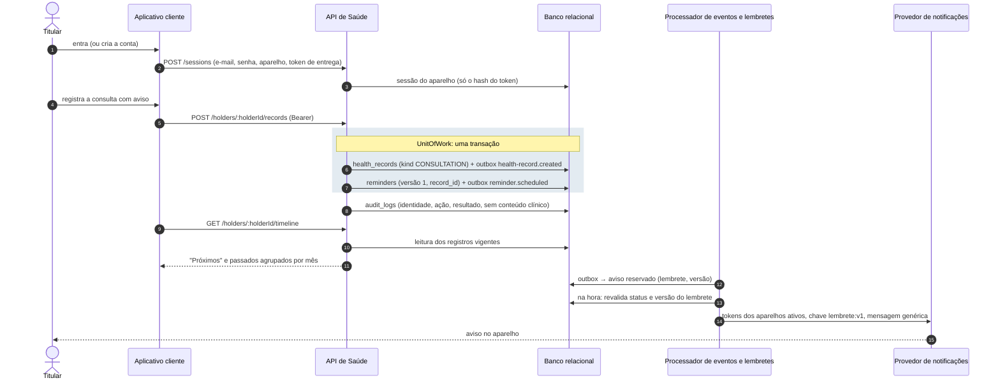

# PersonalHealth

Plataforma para o titular registrar e consultar o próprio histórico de saúde: conta, registros (consultas, exames, vacinas), anexos de exames, indicadores e lembretes.

## Requisitos

* Node.js 20+
* pnpm
* Docker
* `pg_dump` e `pg_restore` (cliente PostgreSQL 17) para o backup

## Arquitetura (C4 nível 2)

```text
Titular ──► Aplicativo cliente ──HTTPS──► API de Saúde ──► Banco relacional ◄── Processador de eventos ──► Provedor de notificações
                                              │                 ▲                  e lembretes
                                              ▼                 │
                                   Armazenamento de anexos ◄── Backup e restauração ──► Repositório de backup
```

Cada contêiner do diagrama corresponde a um pacote do workspace:

| Contêiner C4                         | Pacote                        | Tecnologia                         |
| ------------------------------------ | ----------------------------- | ---------------------------------- |
| Aplicativo cliente                   | `apps/mobile`                 | Expo (React Native)                |
| API de Saúde                         | `apps/api`                    | NestJS, Clean Architecture         |
| Processador de eventos e lembretes   | `apps/worker`                 | Node.js                            |
| Backup e restauração                 | `apps/backup`                 | Node.js (CLI)                      |
| Banco relacional                     | `packages/database`           | PostgreSQL 17 + Prisma             |
| Armazenamento de anexos              | serviço `attachments-storage` | MinIO (S3), bucket privado         |
| Repositório de backup                | serviço `backup-repository`   | MinIO isolado, cópias cifradas     |
| Provedor de notificações             | externo                       | adapter `console` ou `http`        |

`packages/contracts` guarda o contrato dos eventos trocados entre a API e o processador.

### API de Saúde

Organizada em Clean Architecture, um módulo por contexto (`accounts`, `health-records`, `indicators`, `reminders`, `timeline`), cada um com as mesmas camadas:

```text
src/modules/<contexto>/
├── domain/          # entidades, regras e portas de repositório (sem framework)
├── application/     # casos de uso e portas de serviços externos
├── infrastructure/  # adapters: Prisma, S3, hash de senha
└── presentation/    # controllers HTTP e DTOs
```

As dependências apontam sempre para dentro: `presentation → application → domain`, e `infrastructure` implementa as portas declaradas em `domain`/`application`. Os casos de uso são classes puras montadas no módulo Nest por `useFactory`. O teste `apps/api/test/architecture.spec.ts` confere que `domain` e `application` não importam NestJS, Prisma, Express nem o SDK da AWS.

`src/infrastructure/http/` é a borda comum a todos os módulos: validação (mensagens em português), tradução de erros, guarda de sessão e trilha de auditoria.

### Eventos e lembretes (outbox transacional)

1. A API grava a escrita de negócio e o evento em `outbox_events` **na mesma transação**.
2. O processador lê o outbox com `FOR UPDATE SKIP LOCKED` (pode rodar em várias réplicas), executa o handler e marca o evento como processado; falhas são retentadas até `OUTBOX_MAX_ATTEMPTS`.
3. `reminder.scheduled` e `reminder.rescheduled` reservam um aviso por versão do lembrete em `notification_deliveries`; `reminder.cancelled` cancela os avisos reservados.
4. Quando o horário chega, o processador revalida a versão do lembrete, solicita o aviso ao provedor de notificações e marca o lembrete como concluído. O provedor recebe só os tokens dos aparelhos, a chave `lembrete:vN` e uma mensagem genérica.

### Backup e restauração

Cada ponto de recuperação contém o dump do banco e a cópia dos anexos, cifrados com AES-256-GCM antes de sair para o repositório de backup, além de um manifesto com checksums. A restauração decifra e confere todos os checksums antes de tocar no ambiente.

## Fluxo principal

O titular registra uma consulta, vê a consulta na linha do tempo e recebe o aviso no aparelho. Do item da linha do tempo, ele abre o detalhe para remarcar, reagendar ou cancelar o aviso e excluir a consulta.



| Decisão | Onde está no código |
| --- | --- |
| ADR 04: a identidade autenticada define o titular | `infrastructure/http/session.guard.ts`: toda rota exige sessão, e um `:holderId` diferente do da sessão responde como recurso inexistente. Sessões em `modules/accounts` (`POST/GET/DELETE /sessions`); revogar invalida o token e tira o aparelho dos destinos de aviso |
| ADR 04: auditoria sem conteúdo clínico | `infrastructure/http/audit.interceptor.ts` e tabela `audit_logs` |
| RF1.1: consulta passada ou futura, retorno posterior | `modules/health-records/domain/health-record.ts`. Só a consulta aceita data futura; os demais registros continuam só no passado |
| Consulta e aviso na mesma transação | `core/application/unit-of-work.port.ts` e `infrastructure/database/transaction-context.ts`. O health-records chama o reminders pela porta `ConsultationReminders` |
| ADR 03: reagendar ou cancelar invalida a versão anterior | `modules/reminders/domain/reminder.ts` (`version`, `reminder.rescheduled`). No worker, `handlers/reminder-rescheduled.handler.ts` e a revalidação em `notifications/notification-dispatcher.ts` |
| ADR 02: linha do tempo como leitura dos registros | `modules/timeline`: todos os tipos de registro mais os retornos, paginados por data, tipo e id |
| Envio repetido não duplica | `POST /holders/:holderId/records` aceita `id` gerado no aparelho |

No aplicativo, as telas são Entrar/Criar conta, Linha do tempo, Nova consulta e Registro (detalhe, remarcar, aviso, excluir). O token de entrega ainda é um identificador da execução do app, e o provedor `console` só registra o aviso no log. Para chegar ao celular falta um adapter para o Expo Push e o app obter o token com `expo-notifications`, numa development build: desde o SDK 53, o Expo Go no Android não recebe push.

`apps/api/test/e2e/main-flow.e2e-spec.ts` percorre esse fluxo com a API inteira e as classes reais do processador (outbox e dispatcher). Ele cobre o critério de aceite "ao reagendar, só a nova versão do aviso pode ser entregue", a resposta uniforme para outro titular e a revogação do aparelho.

## Estrutura do workspace

```text
apps/
├── api/        # API de Saúde
├── worker/     # Processador de eventos e lembretes
├── backup/     # Backup e restauração
└── mobile/     # Aplicativo cliente
packages/
├── database/   # Schema Prisma, migrations e client compartilhado
└── contracts/  # Contrato dos eventos do outbox
```

## Setup

### 1. Instalar dependências

```bash
pnpm install
```

O `postinstall` gera o Prisma Client e compila os pacotes compartilhados.

### 2. Configurar variáveis de ambiente

```bash
cp .env.example .env
cp apps/mobile/.env.example apps/mobile/.env
```

O `.env` da raiz é lido pela API, pelo processador e pelo backup. Para o backup, gere a chave de cifra com `openssl rand -base64 32` e preencha `BACKUP_ENCRYPTION_KEY`. O `.env` do mobile guarda `EXPO_PUBLIC_BASE_URL`, o endereço da API visto pelo dispositivo ou emulador.

### 3. Subir os serviços locais

```bash
docker compose up -d
```

- **PostgreSQL**: `localhost:5432`
- **Armazenamento de anexos (MinIO)**: API em `http://localhost:9000`, console em `http://localhost:9001` (`minioadmin` / `minioadmin`)
- **Repositório de backup (MinIO isolado)**: API em `http://localhost:9100`, console em `http://localhost:9101` (`backupadmin` / `backupadmin`)

### 4. Aplicar as migrations

```bash
pnpm db:deploy
```

### 5. Rodar

```bash
pnpm dev:api      # API de Saúde em http://localhost:3000
pnpm dev:worker   # Processador de eventos e lembretes
pnpm dev:mobile   # Aplicativo cliente (Expo)
```

A conta pode ser criada no próprio aplicativo ("Criar conta") ou pela API:

```bash
API=http://localhost:3000; JSON='Content-Type: application/json'
curl -s -X POST $API/holders -H "$JSON" -d '{"fullName":"Ana Souza","email":"ana@personalhealth.dev","password":"senha-da-ana"}'
LOGIN=$(curl -s -X POST $API/sessions -H "$JSON" -d '{"email":"ana@personalhealth.dev","password":"senha-da-ana","deliveryToken":"celular-da-ana"}')
TOKEN=$(echo "$LOGIN" | jq -r .token); HOLDER=$(echo "$LOGIN" | jq -r .holder.id); AUTH="Authorization: Bearer $TOKEN"

# consulta com retorno e aviso 1 hora antes
RECORD=$(curl -s -X POST $API/holders/$HOLDER/records -H "$AUTH" -H "$JSON" \
  -d '{"kind":"CONSULTATION","title":"Cardiologia","occurredAt":"2027-03-10T13:00:00Z","followUpAt":"2027-04-10T13:00:00Z","reminder":{"minutesBefore":60}}' | jq -r .id)
curl -s $API/holders/$HOLDER/timeline -H "$AUTH" | jq

# antecipar o aviso para ver o processador entregar (o log do worker mostra o envio)
docker compose exec postgres psql -U root personalhealth \
  -c "UPDATE notification_deliveries SET scheduled_for = timezone('utc', now()) WHERE status = 'RESERVED'"

# remarcar (aviso na versão 2), cancelar o aviso (versão 3), excluir
curl -s -X PATCH $API/holders/$HOLDER/records/$RECORD -H "$AUTH" -H "$JSON" -d '{"occurredAt":"2027-03-12T13:00:00Z"}'
curl -s -X PATCH $API/holders/$HOLDER/records/$RECORD -H "$AUTH" -H "$JSON" -d '{"reminder":null}'
curl -s -o /dev/null -w '%{http_code}\n' -X DELETE $API/holders/$HOLDER/records/$RECORD -H "$AUTH"
```

## Comandos úteis

### Banco de dados

```bash
pnpm db:generate  # gera os tipos do Prisma após mudar o schema
pnpm db:migrate   # cria uma migration nova após mudar o schema
pnpm db:deploy    # aplica as migrations pendentes
pnpm db:reset     # recria o banco
pnpm db:studio    # abre o Prisma Studio
```

### Backup

```bash
pnpm backup:run                 # cria um ponto de recuperação
pnpm -F backup list             # lista os pontos disponíveis
pnpm backup:restore <id>        # restaura banco e anexos
```

### Qualidade

```bash
pnpm build      # compila todos os pacotes
pnpm typecheck  # checagem de tipos
pnpm test       # testes de unidade e regra de dependências
pnpm test:e2e   # fluxo principal de ponta a ponta; exige o docker compose de pé
```

## Endpoints da API

Todas as rotas, salvo `GET /health`, `POST /holders` e `POST /sessions`, exigem `Authorization: Bearer <token>`. Nas rotas `/holders/:holderId/...`, o `holderId` precisa ser o do titular da sessão; outro titular recebe a mesma resposta de um recurso inexistente (404).

| Método | Rota                                                                 | Descrição                         |
| ------ | -------------------------------------------------------------------- | --------------------------------- |
| GET    | `/health`                                                            | Saúde da API e do banco           |
| POST   | `/holders`                                                           | Cadastra titular                  |
| POST   | `/sessions`                                                          | Entra e registra o aparelho (`deliveryToken` opcional); devolve `token`, `sessionId` e `holder` |
| GET    | `/sessions`                                                          | Aparelhos com sessão ativa; `current` marca o desta requisição |
| DELETE | `/sessions/:sessionId`                                               | Revoga a sessão (sair ou aparelho perdido): o token deixa de valer e o aparelho para de receber avisos |
| GET    | `/holders/:holderId`                                                 | Consulta titular                  |
| GET    | `/holders/:holderId/timeline?types=&from=&to=&cursor=&limit=&tz=`    | Linha do tempo: `upcoming` e `past` agrupado por mês, até 50 por página |
| POST   | `/holders/:holderId/records`                                         | Cria registro no histórico. Consulta aceita `professional`, `location`, `followUpAt` e `reminder.minutesBefore`; `id` opcional torna o envio repetível |
| GET    | `/holders/:holderId/records`                                         | Lista o histórico                 |
| GET    | `/holders/:holderId/records/:recordId`                               | Detalhe, com o aviso (`remindAt`, `status`, `version`) |
| PATCH  | `/holders/:holderId/records/:recordId`                               | Corrige ou remarca; remarcar mantém a antecedência do aviso, `reminder: {...}` reagenda e `reminder: null` cancela |
| DELETE | `/holders/:holderId/records/:recordId`                               | Exclui o registro (com o retorno) e cancela o aviso pendente |
| POST   | `/holders/:holderId/records/:recordId/attachments`                   | Gera URL assinada para upload     |
| GET    | `/holders/:holderId/records/:recordId/attachments/:id/download`      | Gera URL assinada para download   |
| POST   | `/holders/:holderId/indicators`                                      | Registra medição de indicador     |
| GET    | `/holders/:holderId/indicators?type=`                                | Lista medições                    |
| POST   | `/holders/:holderId/reminders`                                       | Agenda lembrete                   |
| GET    | `/holders/:holderId/reminders`                                       | Lista lembretes                   |
| PATCH  | `/holders/:holderId/reminders/:reminderId/cancel`                    | Cancela lembrete                  |
