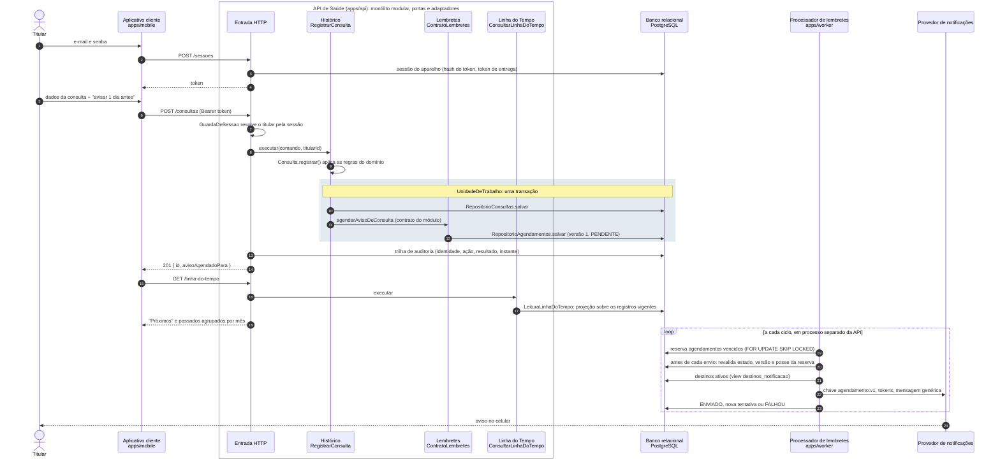
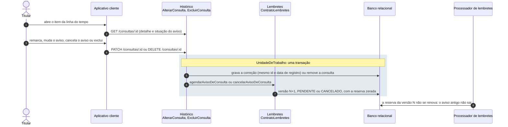
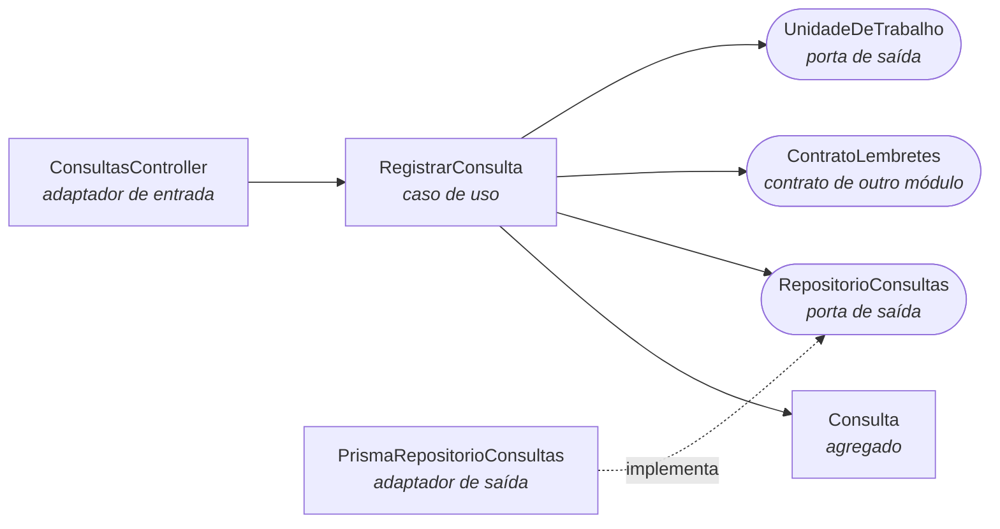

# PersonalHealth: fluxo principal

Prova de conceito da arquitetura descrita em *Histórico e Monitoramento de Saúde: Arquitetura e decisões* (Equipe 7).

O código implementa **um único fluxo**, escolhido porque passa por todas as decisões de arquitetura do documento (ADRs 01 a 04):

> **O titular registra uma consulta, vê a consulta na linha do tempo e recebe o aviso no celular.**

Do item da linha do tempo, o titular abre o detalhe da consulta para remarcá-la, reagendar ou cancelar o aviso e excluí-la. É o que demonstra o critério de aceite de reagendamento e a parte do ADR 03 em que reagendar ou cancelar invalida a versão anterior do aviso.

## O fluxo principal



### Reagendar e cancelar o aviso



### Cada passo no código

| Passos | O que acontece | Componente (C3) | Arquivo | Decisão |
| --- | --- | --- | --- | --- |
| 1–4 | Sessão por aparelho; o servidor guarda só o hash do token | Acesso à Conta | `apps/api/src/modulos/acesso-conta/aplicacao/iniciar-sessao.ts` | ADR 04 |
| 7 | O titular vem da sessão autenticada, nunca do corpo da requisição | Entrada HTTP | `apps/api/src/entrada-http/guarda-de-sessao.ts` | ADR 04 |
| 8–9 | Caso de uso e regras da consulta (retorno posterior, aviso no futuro) | Histórico | `apps/api/src/modulos/historico/aplicacao/registrar-consulta.ts`, `.../dominio/consulta.ts` | RF1.1 |
| 10–12 | Consulta e agendamento confirmados na mesma transação; Histórico só conhece o **contrato** de Lembretes | Histórico → Lembretes | `apps/api/src/modulos/lembretes/contrato.ts`, `apps/api/src/compartilhado/portas/unidade-de-trabalho.ts` | ADR 01, ADR 03 |
| 13 | Auditoria sem conteúdo clínico | Entrada HTTP | `apps/api/src/entrada-http/auditoria.interceptor.ts` | ADR 04 |
| 15–18 | Linha do tempo lida na hora, paginada por data, tipo e id | Linha do Tempo | `apps/api/src/modulos/linha-do-tempo/adaptadores/saida/sql-leitura-linha-do-tempo.ts` | ADR 02 |
| 19–23 | Reserva com identificador, revalidação de versão e posse antes de cada envio, deduplicação e novas tentativas | Processador de lembretes | `apps/worker/src/aplicacao/entregar-avisos-devidos.ts`, `apps/worker/src/adaptadores/prisma-agendamentos.ts` | ADR 03 |
| 22 | O provedor recebe só token, referência técnica e mensagem genérica | Processador de lembretes | `apps/worker/src/portas/provedor-de-notificacoes.ts` | ADR 04 |
| Reagendar 4–7 | Correção mantém a identidade; remarcar mantém a antecedência do aviso; cada mudança no aviso é uma nova versão | Histórico → Lembretes | `apps/api/src/modulos/historico/aplicacao/alterar-consulta.ts`, `excluir-consulta.ts`, `apps/api/src/modulos/lembretes/aplicacao/avisos-de-consulta.ts` | ADR 03, RF1.1 |

## Arquitetura no código

### Contêineres (C4 nível 2) desta prova de conceito

| Contêiner | Pacote | Papel no fluxo |
| --- | --- | --- |
| Aplicativo cliente | `apps/mobile` (Expo) | Telas Entrar, Linha do tempo, Nova consulta e Consulta (detalhe, remarcar, aviso, excluir). Só confirma depois da resposta do servidor |
| API de Saúde | `apps/api` (NestJS) | Monólito modular com portas e adaptadores |
| Processador de lembretes | `apps/worker` (Node.js) | Entrega dos avisos, fora da API por causa do perfil de espera e de falhas |
| Banco relacional | `packages/database` (PostgreSQL 17 + Prisma) | Cópia de referência; cada módulo é dono das suas tabelas |
| Provedor de notificações | externo | Adaptador `console` (desenvolvimento) ou `http` |

O fluxo principal não usa armazenamento de anexos, backup, restauração nem repositório de backup (ADR 05), e também não inclui indicadores, medicamentos nem a recuperação de acesso por canal verificado. Do RF5 há só listar e revogar as sessões do titular. Essas partes continuam no documento e nos diagramas C4.

### API: monólito modular com portas e adaptadores (ADR 01)

Os módulos são os componentes do C3. Todos seguem a mesma estrutura:

```text
apps/api/src/
├── entrada-http/          # Entrada HTTP: guarda de sessão, auditoria, tradução de erros
├── compartilhado/         # portas comuns (UnidadeDeTrabalho, Relogio, TrilhaDeAuditoria) e adaptadores
└── modulos/
    ├── acesso-conta/
    ├── historico/
    ├── lembretes/
    └── linha-do-tempo/
        ├── contrato.ts        # único arquivo que outros módulos podem importar
        ├── dominio/           # entidades e regras, sem framework nem banco
        ├── aplicacao/         # casos de uso: as portas de entrada
        ├── portas/            # portas de saída exigidas pelos casos de uso
        ├── adaptadores/
        │   ├── entrada/       # HTTP: controllers e DTOs
        │   └── saida/         # Prisma/SQL, scrypt
        └── *.module.ts        # composição: liga cada porta ao seu adaptador
```

O componente Histórico, no nível de código do C4 (seção 3 do documento), fica assim:



O teste `apps/api/test/unidade/arquitetura.spec.ts` verifica estas regras de dependência a cada `pnpm test`:

1. Domínio, aplicação e portas não importam NestJS, Prisma nem Express.
2. Domínio só depende de domínio.
3. Aplicação e portas não dependem de adaptadores nem da Entrada HTTP.
4. Um módulo só usa outro pelo `contrato.ts` dele. O arquivo de composição pode importar o módulo Nest do outro para a injeção.

### Processador de lembretes (ADR 03)

O processador segue a mesma organização: o caso de uso `EntregarAvisosDevidos` depende de três portas (`RepositorioDeAgendamentos`, `DestinosDeNotificacao`, `ProvedorDeNotificacoes`), e `src/main.ts` só escolhe os adaptadores.

- **Agendamento durável:** a API grava o agendamento com origem, titular, instante, estado e versão. O processador nunca recebe mensagens da API, apenas lê os agendamentos elegíveis no banco.
- **Reserva:** um único `UPDATE ... FOR UPDATE SKIP LOCKED` reserva o lote com prazo e um identificador de reserva. Várias réplicas podem rodar em paralelo sem pegar o mesmo agendamento.
- **Revalidação e posse:** imediatamente antes de cada envio, o processador confirma que o agendamento continua pendente, na versão reservada e com a reserva dele, e estende o prazo. Se a versão foi substituída ou cancelada, ou se outra réplica assumiu, o aviso é ignorado. Sem isso, num lote lento a reserva dos últimos itens podia vencer e duas réplicas enviariam o mesmo aviso. Todas as escritas exigem a versão e a reserva.
- **Prazo da reserva:** `LEMBRETES_RESERVA_SEGUNDOS` precisa ser pelo menos o dobro de `PROVEDOR_NOTIFICACOES_TEMPO_LIMITE_SEGUNDOS`; senão o processador não sobe.
- **Deduplicação:** a chave enviada é `agendamento:vN`, e o adaptador `http` a manda no cabeçalho `Idempotency-Key`.
- **Falhas:** uma falha transitória gera nova tentativa com espera que dobra a cada vez. Uma recusa do provedor (4xx) ou o fim das tentativas deixa o agendamento em `FALHOU`, com o motivo, para diagnóstico.
- **Destinos:** o processador lê a view `destinos_notificacao`, que o módulo Acesso à Conta publica no banco. Uma sessão revogada (`DELETE /sessoes/:id`) sai da view, e o aparelho perdido para de receber avisos.
- **Até o celular:** o adaptador `console` termina no log do processador. Para o aviso chegar ao aparelho, falta um adaptador para o Expo Push e o app obter o token com `expo-notifications`; desde o SDK 53, o Expo Go no Android não recebe push, então isso exige uma development build.

### Banco

`packages/database/prisma/schema.prisma` separa as tabelas por módulo e não tem chave estrangeira entre módulos. A tabela `consultas` guarda `data_hora` (data do acontecimento) e `registrada_em` (data de registro) em campos distintos, como pedem os invariantes da seção 4. A coluna `agendamentos.reserva` vem da migration `20261124120000_reserva_do_processador`.

## Cenários de qualidade → testes

| Cenário (seção 5) | Onde é verificado |
| --- | --- |
| **Consistência**: depois de confirmada, a consulta aparece na próxima leitura, sem depender do processador; uma remarcação muda a posição na próxima leitura | `apps/api/test/e2e/fluxo-principal.e2e-spec.ts`, passos 4 e 11 |
| **Privacidade**: o titular B recebe a mesma resposta que receberia para um recurso inexistente ao consultar, alterar ou excluir, nada muda, e a tentativa fica na trilha de auditoria; requisições sem sessão também ficam | `fluxo-principal.e2e-spec.ts`, passos 7, 8, 9 e 13 |
| **Disponibilidade**: se o provedor falha, o agendamento continua pendente e pode ser retomado | `apps/worker/test/e2e/processador.spec.ts`, teste "falha transitória" |
| **Modificabilidade**: trocar o provedor muda só o adaptador | `PROVEDOR_NOTIFICACOES=console\|http`; o caso de uso não muda |
| **ADR 03 / critério de aceite**: ao reagendar, só a nova versão do aviso é entregue; aviso cancelado não sai | `apps/api/test/e2e/fluxo-completo.e2e-spec.ts` (API, banco e processador reais) |
| **ADR 03**: cada aviso sai uma única vez, mesmo com reserva vencida ou várias réplicas | `apps/worker/test/e2e/processador.spec.ts`, testes "reserva vencida" e "três réplicas em paralelo" |
| **Recuperação após perda do aparelho** (parte de sessões): a sessão revogada deixa de autorizar e o aparelho antigo deixa de receber avisos | `fluxo-principal.e2e-spec.ts`, passo 16, e `fluxo-completo.e2e-spec.ts`, teste "Recuperação" |
| **RF1.1**: consulta passada no mês do acontecimento, retorno anterior recusado, exclusão leva o retorno e cancela o aviso | `fluxo-principal.e2e-spec.ts`, passos 5, 6 e 14 |

## Como rodar

Requisitos: Node.js 20+, pnpm e Docker.

```bash
pnpm install
cp .env.example .env
cp apps/mobile/.env.example apps/mobile/.env   # EXPO_PUBLIC_BASE_URL = endereço da API visto pelo aparelho
docker compose up -d
pnpm db:deploy     # aplica a migration
pnpm db:seed       # cria as contas de demonstração

pnpm dev:api       # API de Saúde em http://localhost:3000
pnpm dev:worker    # Processador de lembretes
pnpm dev:mobile    # Aplicativo (Expo)
```

Contas de demonstração: `ana@personalhealth.dev` / `senha-da-ana` e `bruno@personalhealth.dev` / `senha-do-bruno`.

> A migration inicial foi refeita para este fluxo. Num banco criado pela versão anterior a ela, rode `pnpm db:reset` antes. A migration `20261124120000_reserva_do_processador` só adiciona uma coluna: `pnpm db:deploy` basta.

### Demonstração pelo terminal

```bash
API=http://localhost:3000

# 1. Entrar
SESSAO=$(curl -s -X POST $API/sessoes -H 'Content-Type: application/json' \
  -d '{"email":"ana@personalhealth.dev","senha":"senha-da-ana","tokenEntrega":"celular-da-ana"}')
TOKEN=$(echo "$SESSAO" | jq -r .token); SESSAO_ID=$(echo "$SESSAO" | jq -r .sessaoId)
AUTH="Authorization: Bearer $TOKEN"; JSON='Content-Type: application/json'

# 2. Registrar consulta com aviso 1 hora antes
CONSULTA=$(curl -s -X POST $API/consultas -H "$AUTH" -H "$JSON" \
  -d '{"dataHora":"2027-03-10T13:00:00Z","especialidade":"Cardiologia","retornoEm":"2027-04-10T13:00:00Z","lembrete":{"antecedenciaMinutos":60}}' | jq -r .id)

# 3. Ler a linha do tempo
curl -s $API/linha-do-tempo -H "$AUTH" | jq

# 4. Antecipar o aviso para ver o processador entregar (o log do worker mostra o envio)
docker compose exec postgres psql -U root personalhealth \
  -c "UPDATE agendamentos SET instante = timezone('utc', now())"

# 5. Remarcar: o aviso é reagendado com a mesma antecedência, na versão 2
curl -s -X PATCH $API/consultas/$CONSULTA -H "$AUTH" -H "$JSON" -d '{"dataHora":"2027-03-12T13:00:00Z"}'

# 6. Cancelar o aviso (versão 3, CANCELADO) e conferir no detalhe
curl -s -X PATCH $API/consultas/$CONSULTA -H "$AUTH" -H "$JSON" -d '{"lembrete":null}'
curl -s $API/consultas/$CONSULTA -H "$AUTH" | jq .aviso

# 7. Excluir a consulta (204)
curl -s -o /dev/null -w '%{http_code}\n' -X DELETE $API/consultas/$CONSULTA -H "$AUTH"

# 8. Sair: revoga a sessão (204); o mesmo token passa a receber 401
curl -s -o /dev/null -w '%{http_code}\n' -X DELETE $API/sessoes/$SESSAO_ID -H "$AUTH"
curl -s -o /dev/null -w '%{http_code}\n' $API/linha-do-tempo -H "$AUTH"
```

### Testes

```bash
pnpm test        # unidade + regras de arquitetura (sem banco)
pnpm test:e2e    # fluxo de ponta a ponta; exige o docker compose de pé
pnpm typecheck
```

Os testes e2e criam bancos descartáveis (`personalhealth_e2e_*`) no mesmo servidor e não tocam no banco de desenvolvimento. `apps/api/test/e2e/fluxo-completo.e2e-spec.ts` sobe a API e roda o caso de uso real do processador contra o mesmo banco, do login até o pedido ao provedor.

## Endpoints

| Método | Rota | Acesso | Descrição |
| --- | --- | --- | --- |
| POST | `/sessoes` | público | Entra e registra o aparelho (token de entrega opcional). Devolve `token` e `sessaoId` |
| GET | `/sessoes` | sessão | Aparelhos com sessão ativa do titular; `atual` marca o desta requisição |
| DELETE | `/sessoes/:id` | sessão | Revoga a sessão (sair ou aparelho perdido): o token deixa de valer e o aparelho sai dos destinos de aviso. 204; de outro titular, 404 |
| POST | `/consultas` | sessão | Registra consulta; `lembrete.antecedenciaMinutos` agenda o aviso. `id` opcional (UUID gerado no aparelho): repetir o pedido devolve a mesma consulta, sem duplicar |
| GET | `/consultas/:id` | sessão | Detalhe com a situação do aviso (`instante`, `estado`, `versao`); para outro titular, responde como recurso inexistente |
| PATCH | `/consultas/:id` | sessão | Corrige ou remarca; campo ausente fica como está, `null` apaga um campo opcional. Remarcar mantém a antecedência do aviso; `lembrete: {antecedenciaMinutos}` reagenda e `lembrete: null` cancela. Cada mudança no aviso é uma nova versão |
| DELETE | `/consultas/:id` | sessão | Exclui a consulta e o retorno e cancela o aviso pendente. 204 |
| GET | `/linha-do-tempo` | sessão | `tipos`, `de`, `ate`, `cursor`, `limite` (até 50), `fuso` |
| GET | `/saude` | público | API e banco no ar |

Erros: 400 formato (mensagens em português, uma por campo), 401 sem sessão válida, 404 recurso inexistente ou de outro titular (mesma resposta), 409 aviso alterado por outra operação ou `id` já usado, 422 regra de negócio violada.
